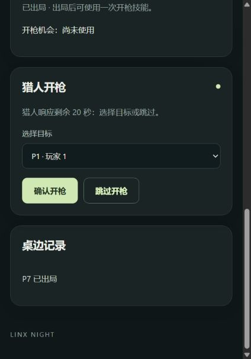

# 猎人响应页面验收

隔离实例 API 5120 / 网页 5121，使用固定九人测试夹具，非真实 Linx 平台结果。

- 浏览器按正常加入流程进入 P7；测试启动器通过领域命令产生猎人死亡。
- 页面显示猎人身份、30 秒响应倒计时、存活目标、确认开枪和跳过开枪。
- 点击跳过后，无需刷新进入依次发言，猎人操作区隐藏并进入旁观。
- API/MCP 开枪、超时、重复、迟到及越权路径见 `tests/hunter-integration.test.mjs`。

