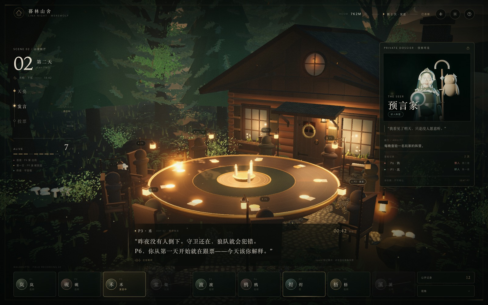
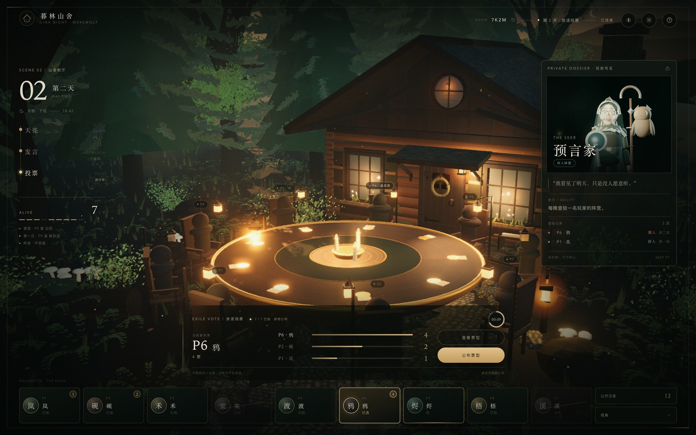
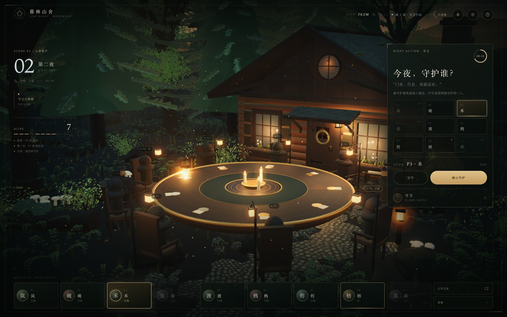
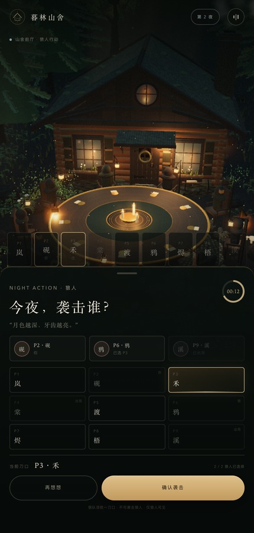
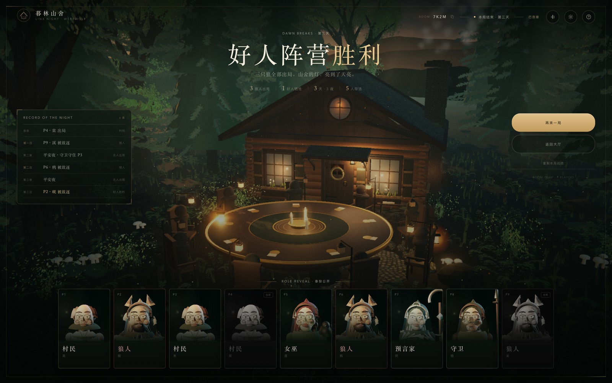
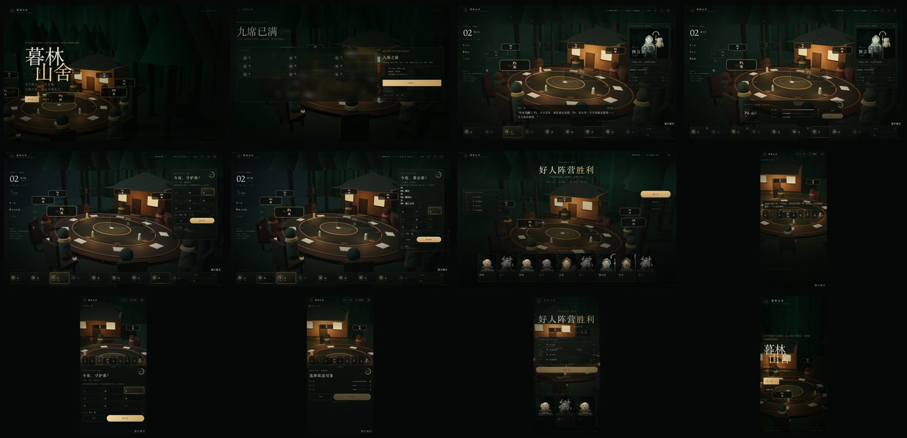

# Issue #135 · 暮林山舍 3D 九人局验收证据

> 状态：已按批准的原型视觉方向实现可运行的前端纵向切片（mock 驱动）。
> 原型确认：2026-10-31，确认语「可以，按这个效果继续」。
> 设计依据：Issue #135 的路由、隐私矩阵与组件边界；#136 的视觉/镜头方向。

## 入口

新版独立入口，**不覆盖现有 `/` 客户端**：

- 本机开发：`http://127.0.0.1:5173/game.html#/lobby`
- 启动页：`game.html#/`
- 大厅：`game.html#/lobby`
- 牌桌：`game.html#/room/WALD-02`
- 结算：`game.html#/room/WALD-02/result`

## 已实现

- 四个路由：launch / lobby / table / result；未知 hash 路径回到启动页。
- 持续存在的 Three.js 山舍世界：木屋、长桌、九席、烛光、雾气、萤火、昼夜光照。
- 阶段只换 HUD/镜头/光照，不重载 3D 世界。
- 九人预女守板子：3 狼、3 村民、预言家、女巫、守卫。
- 夜晚：守卫 → 狼人 → 预言家 → 女巫；白天：天亮 → 顺序发言 → 放逐投票 → 结算。
- 私有行动面板：守卫守护、狼队刀人、预言家查验、女巫用药、发言、投票。
- 移动端底部行动抽屉、座位条、投票面板和横向身份牌。
- 公共 HUD 只接收无角色/无阵营的 `PublicSeat`；身份、狼队、查验和药水只在私有视图或结算页出现。
- 开发演示切换器可查看白天、投票、守卫、狼人、预言家、女巫、结算。

## 证据

### 已批准原型

| 桌面白天 | 桌面投票 | 桌面守卫夜 |
| --- | --- | --- |
|  |  |  |

| 移动狼人夜 | 桌面结算 |
| --- | --- |
|  |  |

### 实现截图

桌面：[启动](implementation/launch-desktop.jpg) · [大厅](implementation/lobby-desktop.jpg) · [白天](implementation/day-desktop.jpg) · [投票](implementation/vote-desktop.jpg) · [守卫](implementation/guard-desktop.jpg) · [狼人](implementation/wolf-desktop.jpg) · [结算](implementation/result-desktop.jpg)

移动：[白天](implementation/day-mobile.jpg) · [守卫](implementation/guard-mobile.jpg) · [投票](implementation/vote-mobile.jpg) · [结算](implementation/result-mobile.jpg)

## 验证

- `npm run typecheck:client-vue`：通过
- `npm run test:client-vue`：8 个测试文件 / 15 个测试通过
- `npm run build:client-vue`：通过，产出 `index.html` 与 `game.html`
- 新增隐私/视图模型测试：公共座位不出现 role/camp；狼队仅狼人视角；守卫不能连续守同一人；投票提交后不自动公开；结算公开全部身份。
- 新增路由测试：四个路由名称/参数、未知路径回退。

## 说明

- 当前为 mock 纵向切片，尚未接真实 `GameGateway`/SSE；演示切换器仅用于前端验收。
- 现有传统客户端与 `/` 入口保持不动；新版从 `game.html` 进入。
