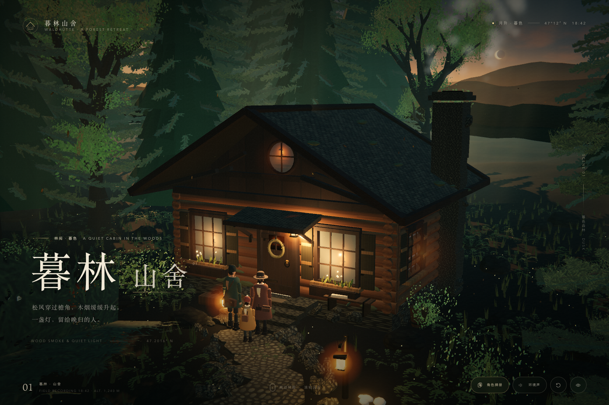
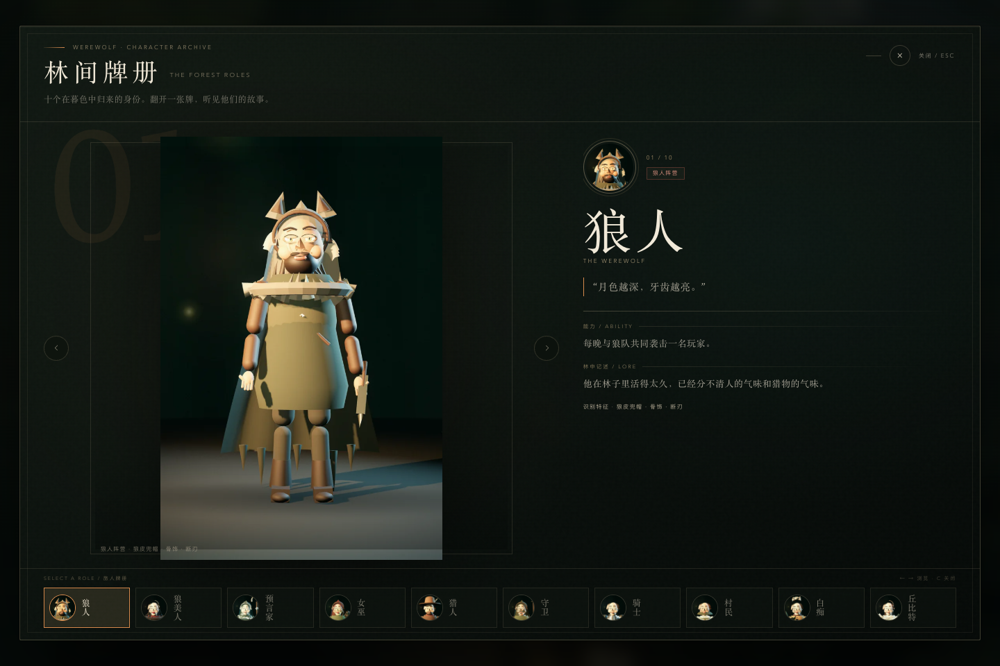

# 暮林山舍启动页与角色牌册原型

## 启动页

启动流程：

1. 进入页面后显示暮林山舍动态森林小屋场景。
2. 镜头完成进入动画。
3. 三位人物从远处石径走到门前。
4. 点击「进入林间」后进入 Linx Night 房间客户端。

## 角色牌册

角色牌册包含 10 位角色：狼人、狼美人、预言家、女巫、猎人、守卫、骑士、村民、白痴、丘比特。

## 交互约束

- 启动页动态场景不可显示嵌套的暮林山舍 loader。
- 启动页动画需要保留人物沿石径走向小屋的原始时间线。
- 启动画面需要适配桌面端与移动端。
- 座位头像使用 `public/assets/werewolf/avatars/` 中的角色素材。
- 视觉主色保持月夜蓝绿、苔绿、琥珀灯光与旧金色。
