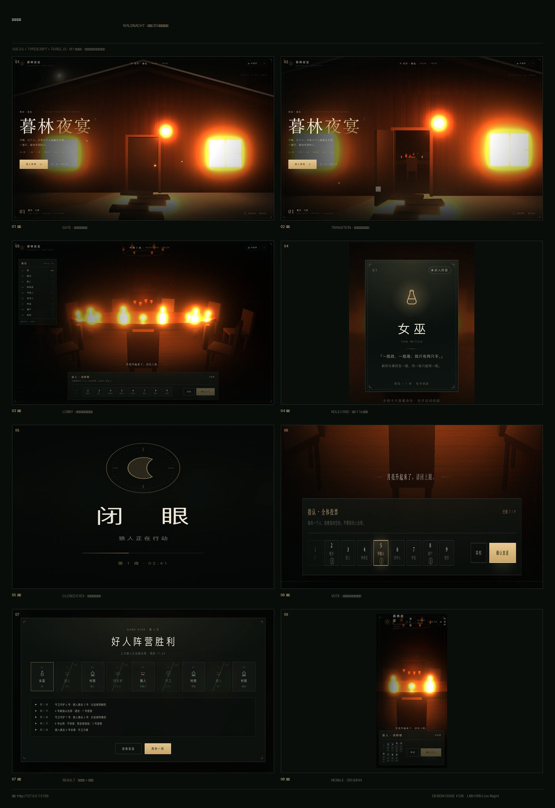
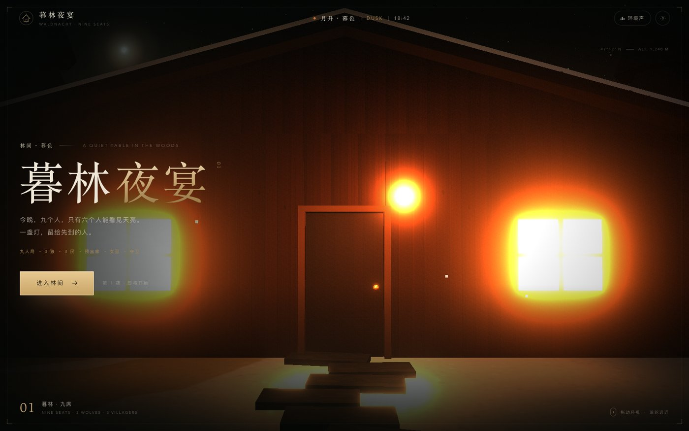
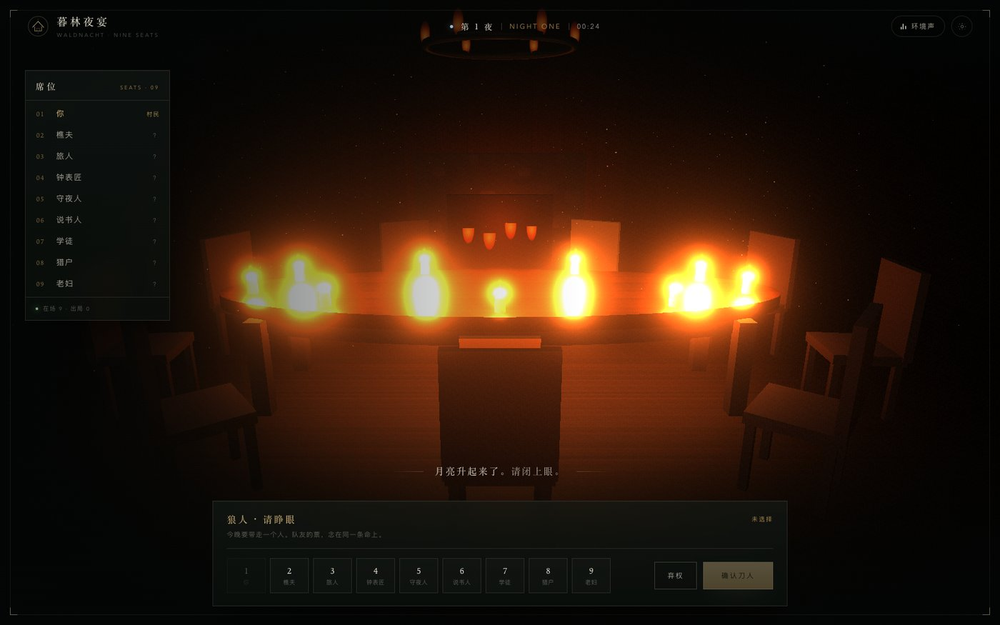
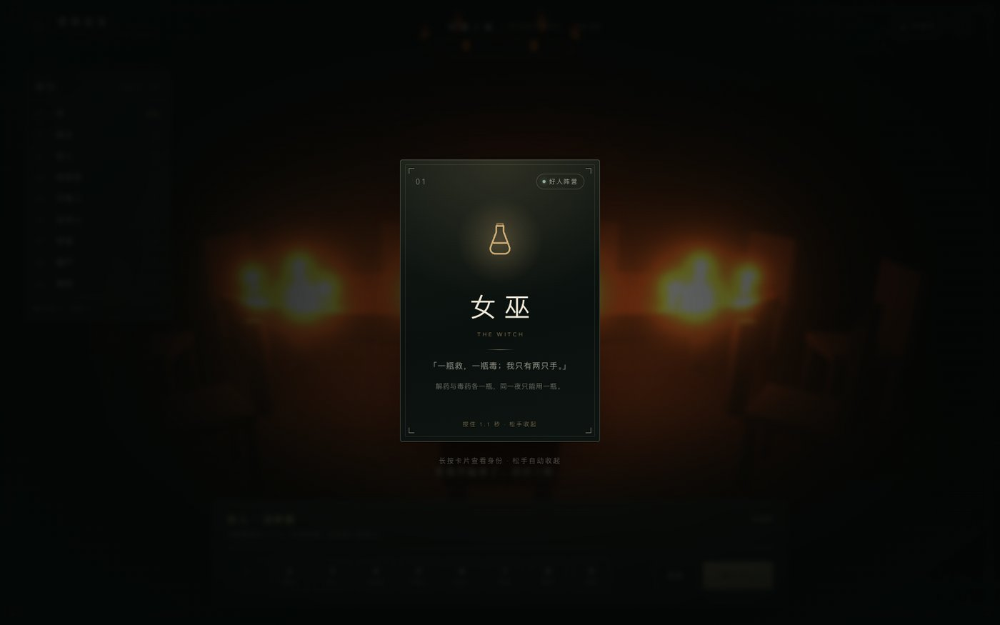
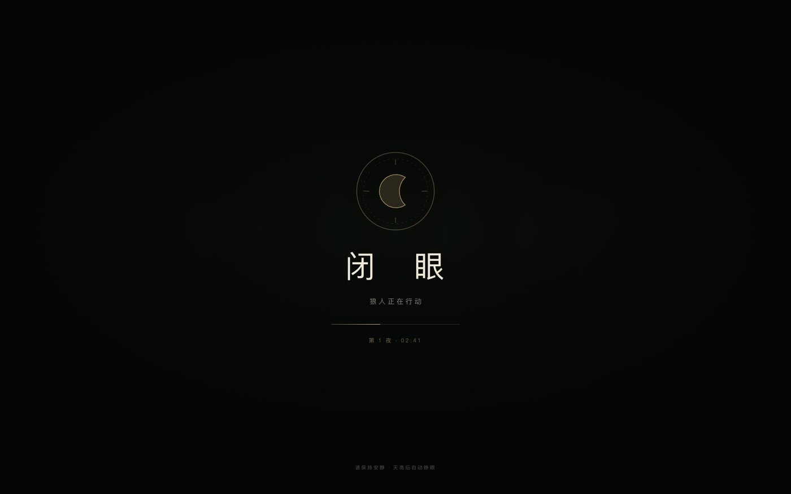
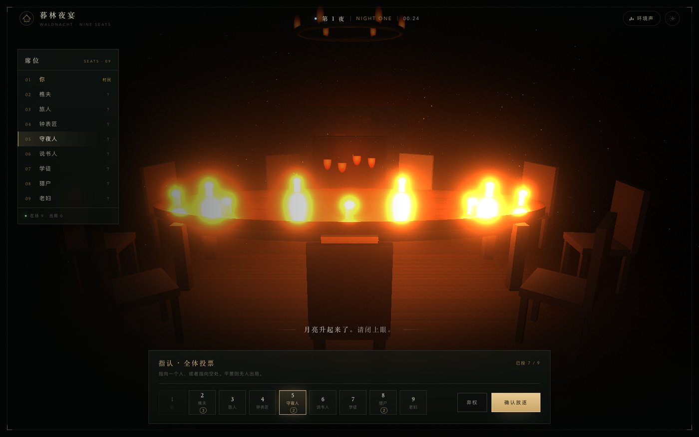
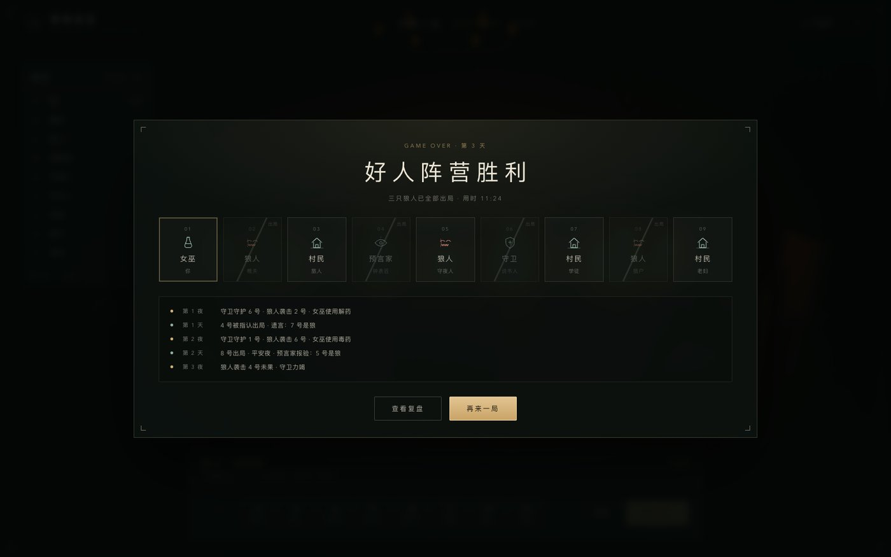

# 暮林夜宴 · 九人局 3D 页面（WALDNACHT）

> 前端舞台原型。设计讨论与开放问题见 issue [#136](https://github.com/LMH168/Linx-Night/issues/136)。
> 代码在 `apps/client-vue/src/features/werewolf/`，入口 `apps/client-vue/werewolf.html`。

## 目标与非目标

**目标**：把「进村 → 入席 → 看牌 → 闭眼 → 指认 → 结算」做成一镜到底的连续空间，镜头运动即页面转场；DOM 只承载行动，不承载叙事。

**非目标**（本阶段）：规则引擎、AI 席位、联网同步。页面不判定任何胜负，所有行动最终提交给服务端。

## 运行

```bash
npm.cmd run dev:client-vue
# http://localhost:5173/werewolf.html
```

构建产物有两页：`dist/index.html`（现有客户端）与 `dist/werewolf.html`（本原型），互不影响。

## 画面



| | |
| --- | --- |
|  |  |
|  |  |
|  |  |

## 视觉系统

取自 `forest-cabin.html`（暮林山舍 / WALDHÜTTE）并收敛为令牌，见 `features/werewolf/styles/tokens.css`：

| 令牌 | 值 | 用途 |
| --- | --- | --- |
| `--ink` | `#f0e9d9` | 主文字 |
| `--gold` | `#d4b27a` | 强调、边框、数字 |
| `--line` | `rgba(224,210,180,.22)` | 发丝线 |
| `--panel` | `rgba(14,20,17,.42)` | 玻璃面板 |
| `--serif` | Iowan / Baskerville / Songti | 标题、数字 |
| `--sans` | Avenir Next / PingFang | 正文 |
| `--ease-out` | `cubic-bezier(.16,1,.3,1)` | 所有转场 |

排版约定：小标题 `letter-spacing: .24em` 且全大写；中文标题字距 `.26em–.34em`；正文行高 1.8–1.9。

## 3D 舞台

- **零外部资源**：木屋、椅子、树、雪、雾、烛火全部 `scene/Stage.ts` 生成，贴图由 `scene/textures.ts` 用 canvas 现画。
- 房间 11 × 9 × 3.55，长桌椭圆 4.2 × 1.4，九席按 `90° − 40°·i` 环绕，1 号席正对镜头。
- 后处理：`RenderPass → UnrealBloom(0.38, 0.6, 0.86) → 颗粒/暗角`，`ACESFilmic` 曝光 1.25，PCF 阴影。
- 镜头 cue（节选）：
  | cue | 行为 |
  | --- | --- |
  | `gate` | 门外 8.8m，fov 45，缓慢横移 |
  | `enter` | 3.6s CatmullRom 穿门，门轴转到 −1.95，雾 0.03 → 0.012，灯光渐亮 |
  | `lobby` | 席前 1.95m 高俯视，fov 56，九席全部在框内 |
  | `select` | 选中席位上浮 + 光环，镜头轻推 |

## 页面状态机

```
gate ──enter()──▶ entering ──progress>0.62──▶ lobby
lobby ──▶ card(看牌) ──▶ eyes(闭眼) ──▶ vote(指认) ──▶ result(结算)
```

- 状态切换由 `WerewolfStage.vue` 的 `overlay` 驱动，3D 只认 `setView` / `setSelected` 两类 cue，不认识规则。
- 调试：`window.__stage`、`window.__jump()`、`window.__demo('card'|'eyes'|'vote'|'result')`。

## 数据契约（下一步）

页面只消费两种数据，后续接服务端时替换适配层即可：

```ts
interface PublicState {
  roomId: string;
  day: number;
  phase: 'LOBBY' | 'NIGHT' | 'DAY' | 'VOTE' | 'RESULT';
  seats: { id: number; name: string; alive: boolean; isSelf: boolean }[];
  narration: { text: string; tone: 'calm' | 'warn' };
}

interface PrivateState {
  seatId: number;
  role: 'wolf' | 'villager' | 'seer' | 'witch' | 'guard';
  availableActions: Action[];   // 由服务端给出，前端不推导
}
```

- 前端**不**计算死亡、胜负、票数；`result` 页的盘面来自服务端结算载荷。
- 现有 `apps/client-vue` 的 `api/client.ts` + `stores/room.ts` 已经是这个形状，接入时替换本目录的 `data/roles.ts` 演示数据即可。

## 里程碑

| 阶段 | 内容 | 状态 |
| --- | --- | --- |
| M1 | 门厅 → 入内 → 九席、身份牌、闭眼、指认、结算（纯展示） | ✅ 本 PR |
| M2 | 接 `PublicState/PrivateState`，用真实房间数据驱动九席与行动面板 | 待排期 |
| M3 | 闭眼节奏与主持播报对齐（服务端 `phase` 驱动，不用定时器） | 待排期 |
| M4 | 性能与移动端打磨：合批、降级 bloom、触控手势 | 待排期 |

## 已知限制

- 本原型不加载任何真实对局数据，结算页为演示盘面。
- 无音效；`TopBar` 的喇叭按钮目前是占位。
- SwiftShader 下帧率很低（截图均来自软件渲染），真机需在 GPU 环境复测。
