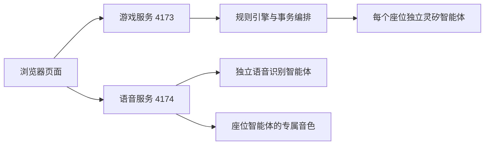

# 架构与实现

## 数据流

`start.mjs` 同时启动两个服务，任一服务退出会终止另一服务。服务端通过 OTA 获取临时 token，再通过带鉴权头的 WebSocket 连接灵矽。浏览器不持有平台密钥，也不直接建立需要自定义鉴权头的灵矽连接。

## 游戏与信息隔离

`engine.mjs` 持有完整身份和技能状态，输出给真人与每位 AI 的视角分别裁剪。好人只能知道公开事件、自己身份和合法私密记录；狼人额外知道队友。平台智能体关闭长期记忆，避免跨局使用历史身份信息。

发言、狼刀、查验、用药、投票与开枪由各座位专属智能体提议。`linx.mjs` 验证结构化 JSON 与 `allowedActions`，`orchestrator.mjs` 在状态副本上处理阶段；任一决策失败不提交部分结果。投票使用同一公开快照，未公布票型不传给后续玩家。自然语言发言仍可能出现推理错误。

对局在内存中保存，每套设备同时只运行一局灵矽游戏。阶段处理期间加锁；这不等同于生产环境的持久化、分布式锁或幂等请求处理。

## 语音输入

`public/recorder.js` 通过 getUserMedia 和 AudioWorklet 采集麦克风，兼容环境回退至 ScriptProcessor，重采样为 16kHz 单声道 signed-int16 PCM。录音结束后提交给语音服务，最长 60 秒；ASR 使用独立设备的 manual listen / STT 返回转写，不将模型生成内容当作识别结果。用户检查文字后再提交发言。

录音仅在内存中处理。语音识别设备不接收玩家身份和私密对局状态。离开页面、取消或失败时停止麦克风与请求。

## 语音输出

AI 发言文字通过游戏服务获取；播放时语音服务向对应座位设备发送 `listen.detect.text_response`，合成相同内容。`tts.mjs` 根据 hello 的音频参数，将 PCM 封装成 WAV，或将裸 Opus 封装成有 CRC 和 granule 的 Ogg，由浏览器 Audio 播放。主持人使用浏览器 speechSynthesis。

当前不是边生成边播放：文本和音频分两次调用，会增加延迟及 TTS 消耗。取消、切换玩家或开启麦克风时停止旧音频。

## 配置与扩展

`.env` 保存 API 密钥；`.linx/players.json` 保存安装 ID、智能体 / 虚拟设备关联与音色，OTA token 仅存在于内存。初始化脚本按安装标识复用资源并保存进度。平台 API 同时检查 HTTP 状态和业务 `code === 0`。

本机服务绑定 127.0.0.1，语音服务限制允许的游戏页面来源。后续若支持公网或多人房间，需要统一 HTTPS 网关、身份认证、座位权限、请求幂等、限流和事件持久化；也可合并生成与音频返回，减少重复调用。当前源码未实现这些能力。
