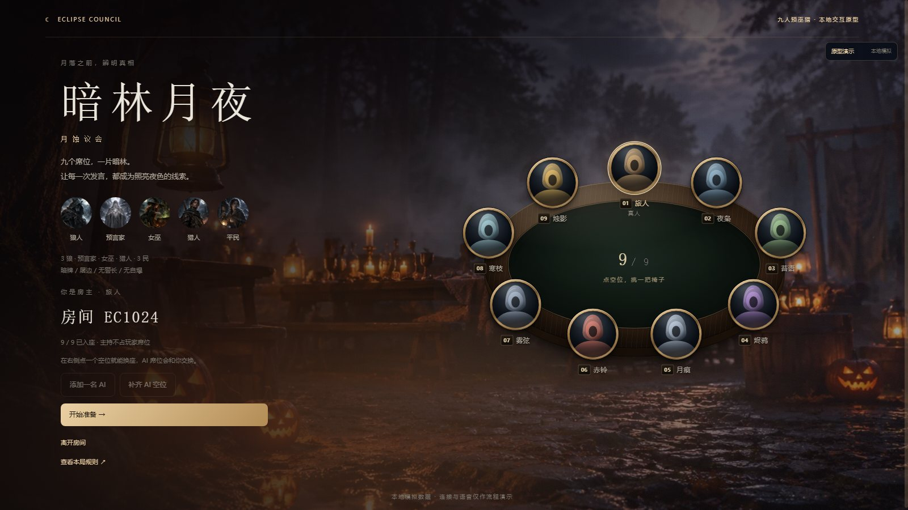
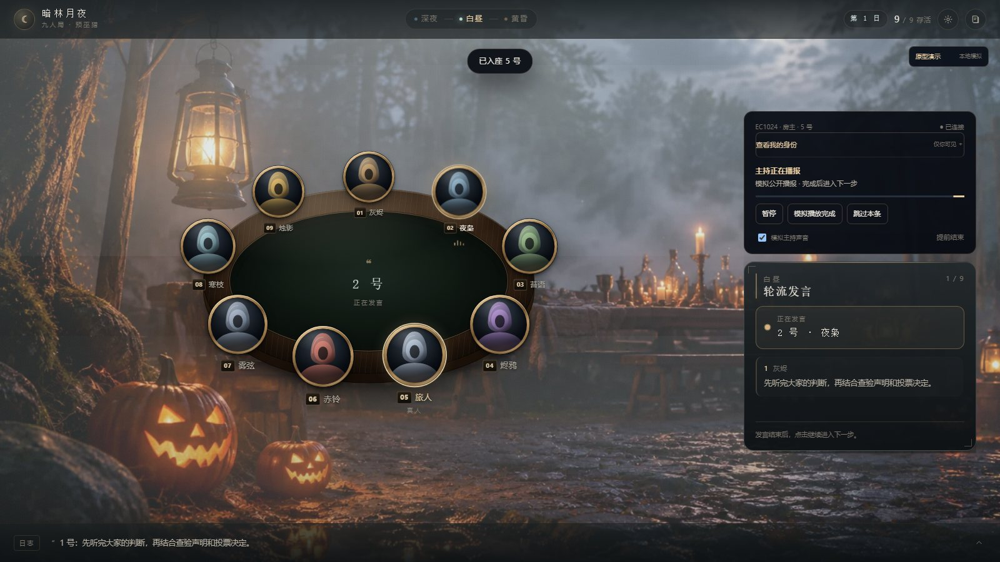
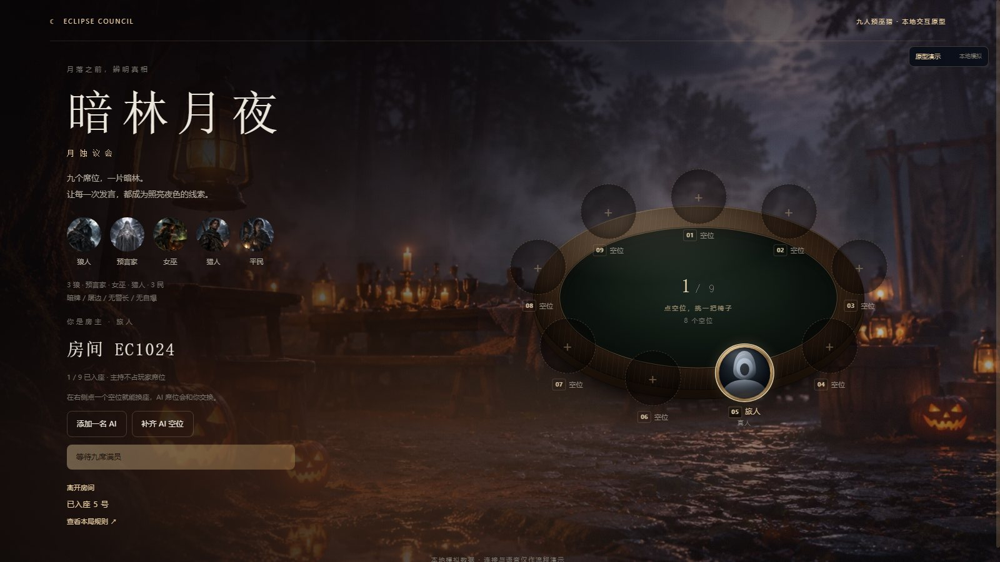
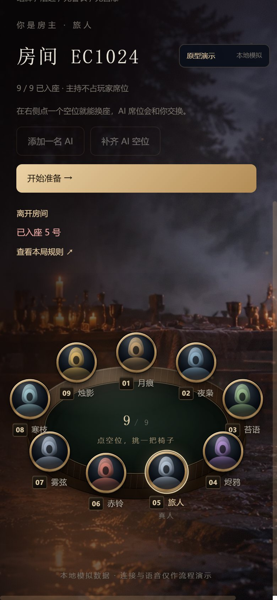

# 月蚀议会 · 前端流程原型

仅用于 Linx-Night 流程和界面评审。全部房间、AI、主持播放、录音与转写都是本地模拟，不发送网络业务请求，也不修改正式客户端或后端。

这是一个**独立的设计沙盒**，用来先把视觉和流程跑通，再决定哪些东西值得搬进 `apps/client-vue`。它不是正式客户端的替代品，也不共享后端的领域代码。

## 打开

- **双击 `demo.html`** 即可离线打开，无需服务端、无需安装依赖。单文件内联了全部脚本、样式和图片，适用于现代 Chrome / Edge。
- 开发预览：`npm install && npm run dev`，打开 http://127.0.0.1:5178/。
- 生产目录：`npm run build`；单文件：`npm run build:single`（产物在 `dist-single/index.html`）。

> `demo.html` 是一次性构建产物，`index.html` 才是 Vite 的开发入口；两者不要同时就地改名。

## 这一版的视觉改动

**大厅 · 同一机位，停在黄昏**：大厅不再单独画一套背景，它和对局共用同一张摄影底图，只是光停在"黄昏"这一档——所以创建房间不是换场景，而是**同一束光慢慢灭下去**。左侧压暗的斜向渐变保证文字可读；右侧就是开局要用的那张桌子，椅子先摆好。

**对局 · 四档光时**：

- 一局的时间线是 `黄昏 → 深夜 → 破晓 → 白昼 → 黄昏投票`，每轮走完整一圈，玩家能数出过了几天。
- 每档光是一层**固定的渐变**（`wash`），切光只改 `opacity`；底图滤镜是静态的，只画一次。不再用"给夜景调滤镜"的方式表达白天。
- 白昼走**阴天**而不是晴天：统一抬亮、去饱和、灯火全灭。既符合狼人杀的压抑感，也保护面板上的文字对比，还不用担心同一张夜空底图做晴天穿帮。
- 玻璃面板、顶栏、日志条的颜色由 `data-light` 驱动（`--panel-bg` / `--chrome-rgb` / `--scene-tint`），换光时 UI 跟着一起变，不再是永远钉在画面上的黑玻璃。
- 结算页把程序化绘制的**剪影小屋**放回来当片尾，半透明压暗后透出来。

| 黄昏 | 深夜 | 破晓 | 白昼 |
| --- | --- | --- | --- |
|  |  |  |  |

**渲染预算**：整帧只有一层底图 + 四层静态调色 + 两条雾带 + 灯火 + 暗角 + 颗粒，另加一张 0.55 倍分辨率、24fps 的粒子画布。全场景**没有** `backdrop-filter`、`mix-blend-mode`、逐帧改色动画；换光、雾气、灯火动的都只有 `opacity` 和 `transform`，交给合成器。

**开局前先摆好九把椅子**：

- 建好房间，牌桌和九个席位立刻出现，你默认坐 1 号。点任意空位就走过去；点 AI 的席位会和它换座——AI 带着自己的名字挪到你的旧位子，所以席位身份不会错乱。
- 大厅和对局共用同一套几何：同一段弧长算法、同一个 `TableTop` 组件、同一套席位卡。**选的位置就是开局后的位置**，转场时不跳。
- 席位分三种状态：你自己（金色双圈 + 真人）、AI（黄铜圈，可换座）、空位（虚线空椅圈）。换座只有房主能做，加入者看到的是"等待房主安排席位"。

**桌与席位重做**：

- 桌面换成"胡桃木台面 + 深绿绒布 + 黄铜嵌线"三层材质。木纹用两组极淡的直纹，替掉了原来的同心圆——那圈 `repeating-radial-gradient` 在 600px 的桌上会读成唱片纹。桌沿是整块木头让出的厚度，不再是描一圈亮边。
- 席位头像的金属圈从多段 `conic-gradient` 换成一条方向性 `linear-gradient`：小尺寸不糊、不发脏。圈薄了，肖像大了约三成，桌面变大时席位跟着变大。
- 席位号从左上角凸出的圆标挪进名字行，做成小铜牌；角上只留狼队友、票数、出局这些真需要被看见的状态。
- 绒布亮度压到木面之下（实测绒布 23–25、木面 30–35），让九个头像成为画面里最亮的东西。

手机尺寸下牌桌会落到首屏下方，滚动即可；席位缩到 46–57px，仍保留换座点击区域。

> `src/assets/scene/gathering.webp` 由 gpt-image-2 生成（提示词即本 PR 描述里的画面描述），其余场景与 UI 元素均为代码绘制。

## 评审路径

1. 输入昵称，创建房间。先在右侧牌桌上点一个空位把自己坐下（再点 AI 席位可以换座），然后添加 AI 或一次补齐九席。也可用演示房间号 **EC1024** 加入，观察普通玩家权限。
2. 满九席后由房主开始准备，全部 AI 和独立主持就绪后发牌。独立主持不占玩家席位。
3. 收起身份后，用 **继续流程** 逐步演示夜间行动、天亮、遗言、白天发言、放逐和下一夜。
4. 开启模拟主持声音时，点击 **模拟播放完成** 后继续；暂停不确认完成，失败可重试，房主可跳过当前条目。
5. 发言可以直接输入，或选择模拟录音→结束模拟录音→转写草稿→编辑确认。草稿不自动提交。
6. 对局结束可翻牌和查看公开复盘；房主也可确认提前结束。重新开局返回房间，不会立即随机重开。

右上角 **原型演示** 可选房主／加入者、五种本人角色，以及身份牌、夜间、白天、投票、PK、猎人、遗言、准备失败、AI 失败、断线、播放失败和结算。普通玩家的“模拟房主开局”只放在演示工具中。场景切换会清理旧请求、倒计时、录音草稿和目标选择。

## 规则基线

以同目录外 Linx-Night 当前领域代码及公开／私密投影为准：九人预巫猎、屠边、无警长、无自爆；存活号码递增发言；狼人确认一致目标；女巫每夜一种行动，可自救；被毒猎人也有响应。与旧版原型的逆时针、狼人多数决、自爆和被毒不开枪规则不同。

- PK 台上只发言，第二轮仅台下投候选人；再次平票无人出局。
- 猎人和遗言各 30 秒，遗言最多 200 字。先处理猎人响应，再判断胜负和遗言；首夜死亡和白天放逐有遗言资格。
- 身份收起时席位不展示私密角色。出局不翻牌，投票结算前不公开目标与票数；放弃开枪只进入本人私密记录。
- AI 与连接失败不会自动切换为规则机器人。固定模拟票型用于确定性演示，不代表 AI 策略质量。

## 角色素材

五种角色插画已补齐，存放在 `src/assets/portraits/`，使用 `wolf.webp`、`seer.webp`、`witch.webp`、`hunter.webp`、`villager.webp`，由现有组件自动加载。大厅、私密身份、合法可见的狼队友和结算页复用这些图片；未公开身份的席位仍显示统一剪影。

## 检查

- `npm test`：引擎、信息隔离和原型流程回归。
- `npm run typecheck`：Vue / TypeScript 检查。
- `npm run build`：类型检查 + 生产构建。

本目录只保留源码与构建产物，浏览器审计脚本（需要独立启动带 `--headless=new --remote-debugging-port=9333` 的浏览器）没有一并带进来。

## 演示限制

不支持真实跨浏览器联机、真实 AI、语音采集、持久化或刷新恢复；刷新重置模拟房间。所有内容只用于产品流程评审，不代表后端、权限认证或平台接入已验收。
