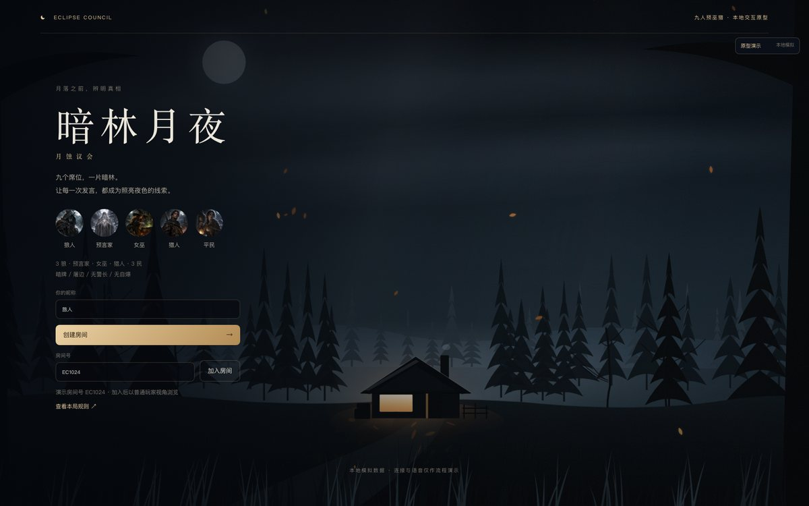
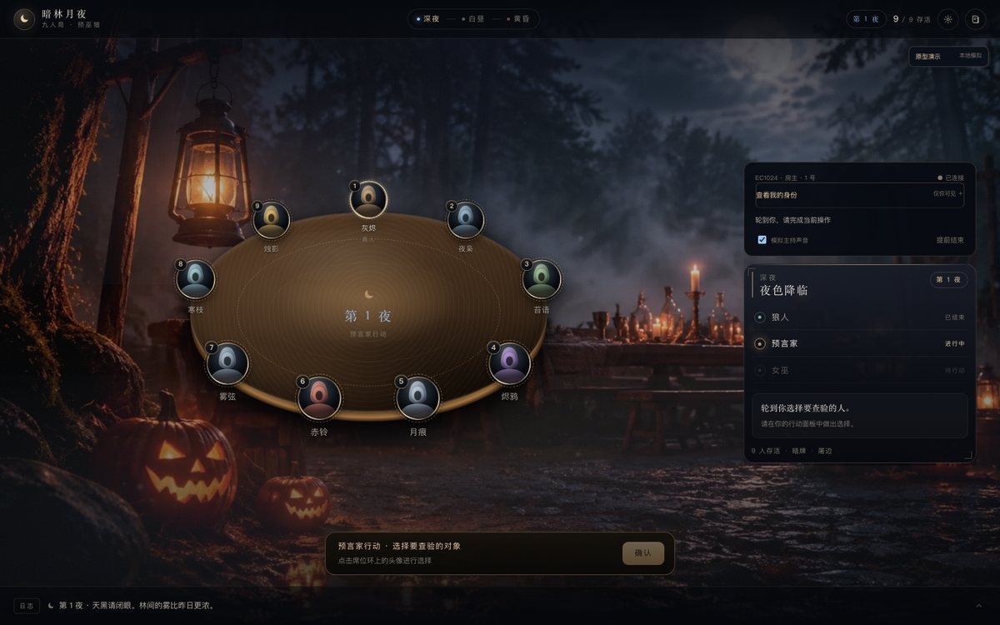

# 月蚀议会 · 前端流程原型

仅用于 Linx-Night 流程和界面评审。全部房间、AI、主持播放、录音与转写都是本地模拟，不发送网络业务请求，也不修改正式客户端或后端。

这是一个**独立的设计沙盒**，用来先把视觉和流程跑通，再决定哪些东西值得搬进 `apps/client-vue`。它不是正式客户端的替代品，也不共享后端的领域代码。

## 打开

- **双击 `demo.html`** 即可离线打开，无需服务端、无需安装依赖。单文件内联了全部脚本、样式和图片，适用于现代 Chrome / Edge。
- 开发预览：`npm install && npm run dev`，打开 http://127.0.0.1:5178/。
- 生产目录：`npm run build`；单文件：`npm run build:single`（产物在 `dist-single/index.html`）。

> `demo.html` 是一次性构建产物，`index.html` 才是 Vite 的开发入口；两者不要同时就地改名。

## 这一版的视觉改动

**大厅 · 山林小屋**：整张背景是程序化绘制的 SVG 场景（远中近三层林带、雾气、飘落的叶子、会摇曳的草），不是位图。用的是确定性随机（`mulberry32`），刷新不会换一个场景，也不会闪。唯一光源是小屋的窗，暖光溢到雪地和树干上，冷蓝夜色压住四周。

**对局 · 摄影底图 + 立体桌**：

- 背景换成一张写实夜景摄影（林间集会空地、雾、被薄云遮住的满月、提灯与南瓜灯的暖光、远处长桌的卡牌与蜡烛），叠了漂移的雾带、烛火呼吸、暗角和胶片颗粒。同一张底图靠调色区分昼夜——夜里压暗抽暖偏蓝紫，白天提亮去饱和偏冷灰。
- 桌子是透视椭圆：桌面、桌沿厚度、边缘光、投影分层绘制，后用 `drop-shadow` 浮起来。
- 九个席位按**弧长**（不是等角度）均分在桌沿上——等角度会让椭圆两端挤成一堆。相邻间距从 113–195px 收敛到 145–158px。

**席位头像**：金属镜圈（`conic-gradient` 做方向光）+ 内凹肖像槽（内阴影 + 顶部受光边）+ 玻璃反光 + 金属铭牌号码。改动前镜圈亮度 46.5 比肖像 83.4 还暗，等于没有框；改完镜圈 75.8、肖像 65.7，框才立住。

> `src/assets/scene/gathering.webp` 由 gpt-image-2 生成（提示词即本 PR 描述里的画面描述），其余场景与 UI 元素均为代码绘制。

## 评审路径

1. 输入昵称，创建房间；添加 AI 或一次补齐九席。也可用演示房间号 **EC1024** 加入，观察普通玩家权限。
2. 满九席后由房主开始准备，全部 AI 和独立主持就绪后发牌。独立主持不占玩家席位。
3. 收起身份后，用 **继续流程** 逐步演示夜间行动、天亮、遗言、白天发言、放逐和下一夜。
4. 开启模拟主持声音时，点击 **模拟播放完成** 后继续；暂停不确认完成，失败可重试，房主可跳过当前条目。
5. 发言可以直接输入，或选择模拟录音→结束模拟录音→转写草稿→编辑确认。草稿不自动提交。
6. 对局结束可翻牌和查看公开复盘；房主也可确认提前结束。重新开局返回房间，不会立即随机重开。

右上角 **原型演示** 可选房主／加入者、五种本人角色，以及身份牌、夜间、白天、投票、PK、猎人、遗言、准备失败、AI 失败、断线、播放失败和结算。普通玩家的“模拟房主开局”只放在演示工具中。场景切换会清理旧请求、倒计时、录音草稿和目标选择。

## 规则基线

以同目录外 Linx-Night 当前领域代码及公开／私密投影为准：九人预巫猎、屠边、无警长、无自爆；存活号码递增发言；狼人确认一致目标；女巫每夜一种行动，可自救；被毒猎人也有响应。与旧版原型的逆时针、狼人多数决、自爆和被毒不开枪规则不同。

- PK 台上只发言，第二轮仅台下投候选人；再次平票无人出局。
- 猎人和遗言各 30 秒，遗言最多 200 字。先处理猎人响应，再判断胜负和遗言；首夜死亡和白天放逐有遗言资格。
- 身份收起时席位不展示私密角色。出局不翻牌，投票结算前不公开目标与票数；放弃开枪只进入本人私密记录。
- AI 与连接失败不会自动切换为规则机器人。固定模拟票型用于确定性演示，不代表 AI 策略质量。

## 角色素材

五种角色插画已补齐，存放在 `src/assets/portraits/`，使用 `wolf.webp`、`seer.webp`、`witch.webp`、`hunter.webp`、`villager.webp`，由现有组件自动加载。大厅、私密身份、合法可见的狼队友和结算页复用这些图片；未公开身份的席位仍显示统一剪影。

## 检查

- `npm test`：引擎、信息隔离和原型流程回归。
- `npm run typecheck`：Vue / TypeScript 检查。
- `npm run build`：类型检查 + 生产构建。

本目录只保留源码与构建产物，浏览器审计脚本（需要独立启动带 `--headless=new --remote-debugging-port=9333` 的浏览器）没有一并带进来。

## 演示限制

不支持真实跨浏览器联机、真实 AI、语音采集、持久化或刷新恢复；刷新重置模拟房间。所有内容只用于产品流程评审，不代表后端、权限认证或平台接入已验收。
